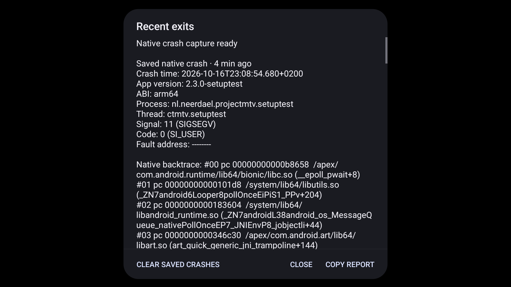

# Fire TV preset-switch compatibility and local crash capture

The reporter's Amazon AFTKRT runs Fire OS 8 / Android 11 (API30), with a PowerVR GE9215 and a 32-bit application ABI. The first real preset works; later changes can crash even with Lightweight/0s and with background compilation/program binaries disabled. Supplied photographs record a foreground native crash and separate background exits, not a native backtrace. The visible load completed seven seconds before that crash; prewarming was idle five seconds before it. These records do not identify the faulting function.

## Framebuffer candidate

Patch0036 implements a vendor-gated complete-FBO retirement guard based on [Chromium/Skia's corrected workaround](https://skia.googlesource.com/skia/+/02b14267cb023e7ec9fc52618bd12464ceb6afb7). It does not change preset equations or shader calculations. A single bind to framebuffer zero can leave the retired object as the driver's previous complete binding; the guard replaces both read/draw references before deletion and restores surviving bindings.

The real-GL test hooks actual engine operations, including preset changes, resizing, teardown, pooled textures and replacement contexts. Ordinary deletion in the same test fixture produces 124 current/previous/previous-complete hazards among 264 deletions. Selecting the PowerVR guard produces zero hazards, with one retained guard per context and matching nonblank output. Vendor spoofing selects a branch on the actual Mac GL backend; it does not emulate the proprietary PowerVR driver. All 65 sanitizer renderer controls pass at the source checkpoint; the final native runner also checks JNI reset ordering and host framebuffer retirement.

This is an engine compatibility candidate, not confirmation that the reported Fire TV crash is fixed. No affected PowerVR hardware was operated.

## Native capture journey

Source-built xCrash is pinned and hash-recorded in [its provenance](../../../../third_party/xcrash/PROVENANCE.md). Both ARM ABIs package the capture library and dumper inside the core AAR; Java classes and license notices are self-contained. Capture is process-wide once the engine initializes. Reports stay in private no-backup storage. Optional logcat, FD/network/maps/other-thread collection and Java/ANR handlers are disabled; the stored native file still contains register/stack memory. The viewer and copied text omit raw memory sections, cap each displayed report at 32,768 characters and show at most five reports.

An owned API34 ARM64 emulator, configured at 1920x1080 with host GPU acceleration, verified:

1. Start the separate `.setuptest` app with native capture ready.
2. Deliver SIGSEGV from the instrumentation-only `native_crash_capture` case. This is a test-delivered signal (`SI_USER`), not a reproduced invalid-memory access or driver fault. The process terminates normally through Android's crash handling.
3. Observe a 63,754-byte private native tombstone.
4. Start a new process using `native_crash_report`. The reader finds the saved signal and real native backtrace/module-relative PCs; the Recent exits dialog displays them and its action buttons fit within the screen.

The device fingerprint was `Android/sdk_phone64_arm64/emu64a:14/UE1A.230829.036.A1/11228894:userdebug/test-keys`. This is an emulator result, not Fire TV or whole-platform qualification. The upstream null-dereference test did not produce a fault with this compiler, so the final journey uses the framework's explicit fatal-signal API instead. No crash trigger is exposed in production UI.

The capture and report cases are in `NativeCrashSetupTest`; commands are documented in the [development guide](../../../user-guide/development.md#use-the-engine-in-another-app). Raw native dumps and generated APK/AAR files are not committed. Artifact hashes and the 205 passing app/core JVM tests are recorded in [the validation summary](validation-summary.json). The APK shown is the isolated setup role (`2.3.0-setuptest`), not a published release.

## Remaining limits

- Affected Fire TV crash resolution and performance require reporter confirmation.
- The API34 signal test establishes capture/restart/display, not complete unwinding on every OEM or API level. Missing stacks are labelled rather than inferred from engine breadcrumbs.
- macOS renderer controls use desktop GL. Linux/GLES-only checks and current-head external review/CI remain separate gates.
- The retired cache/prewarm settings did not resolve the reported crash. Their core APIs and historical trail parser remain compatible; current app startup restores enabled defaults for old saved Off choices.
