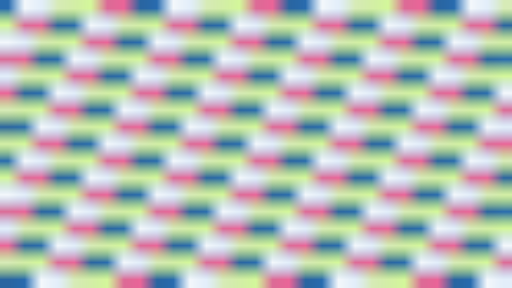

# PowerVR framebuffer blit crash

## Report and source binding

The reporter supplied the standalone ProjectM 2.3.55 native report after Milkbeat 1.0.12 also continued crashing. A preset switch is not required. The report records SIGSEGV/SEGV_MAPERR at `0x88`, on the GL render thread, inside the PowerVR driver's `glBlitFramebuffer`. Its ARM `libprojectmtv.so` build ID and 1,612,560-byte size match the published 2.3.55 AAR exactly. Personal photographs and randomized installation paths are not committed; [transcribed diagnostic fields](reported-crash.json) retain the useful identifiers.

Rebuilt unchanged main `76757e6e` using the pinned NDK. The rebuild's complete ELF build ID differs, so no whole-binary identity is claimed. Its `.text` bytes and virtual address match the released library exactly: address `0x85390`, 910,400 bytes, SHA-256 `990c0cea15b0fbbe94fc0f71e5cf4c3a373242697c4a1e9384cba68840426c3b`. The corresponding unstripped symbols map the caller to `Renderer::Framebuffer::SetSize`, line124, through `MilkdropPreset::RenderFrame`, line96, and `ProjectM::RenderFrame`, line229. This is the old-image resize copy; Auto can trigger it during an unchanged preset.

## Candidate

Patch0038 uses a cached fullscreen textured draw on Imagination/PowerVR contexts for framebuffer resizing, Native-trails detail recombination and host-scaled presentation. It uses the existing Shader and Sampler implementations, preserves touched state, routes the image copy only to colour zero, and finishes resizing auxiliary attachments before copying. Primary colour formats remain unchanged. Other GPUs retain framebuffer blits. Copy resources remember the existing context-forget generation and drop stale names without GPU deletion on a replacement context.

## Local controls

- The original real-GL resize control fails because the PowerVR-selected branch calls `glBlitFramebuffer`; the candidate avoids that call.
- Resize, mixed RGBA/integer attachment, actual host C API, caller-state, Native-trails and replacement-context controls pass on Mac GL. Small scaling is byte-identical; the 4K scaling control differs by at most one 8-bit channel step. Nearest detail recombination is byte-identical. Repeated resize reuses its copy program.
- The first replacement-context control caught stale copy resources deleting an aliased new program. Context-generation cleanup corrects it and the control passes.
- The JNI presentation control fails before routing the PowerVR case through the new copy API and passes afterwards; ordinary presentation retains its blit.
- Both ARM debug/release core builds and app packages pass; both release AAR libraries contain the new shader. All38 patches apply to clean pinned source. The shader also links with `glslangValidator -l` as GLSL ES3.00.
- The complete native script passes, including66 ASan/UBSan renderer controls and JNI/fake-engine checks. Its standalone transition-overlay GL check is skipped on macOS because host EGL/GLES development files are absent; the separate Android copy worker executes on GLES3.0.
- All207 JVM controls pass in each of debug and release (app117/core90). Strict MkDocs and10 collection-distribution controls pass. The rebuilt official archive matches its regenerated lock.

Android/GLES validation also exposed a separate source-retirement hazard in the reference blit path: after resizing, deleting the texture still attached to the temporary read framebuffer detached an unrelated new draw attachment on the emulator translator. Explicitly detaching the read source and unbinding the read framebuffer before releasing the old texture prevents that. The control checks attachment identity, format and completeness before comparing images, and counts any unrelated attachment deletion.

## Android/GLES comparison

The task-owned API34 ARM64 emulator uses Android 14 fingerprint `Android/sdk_phone64_arm64/emu64a:14/UE1A.230829.036.A1/11228894:userdebug/test-keys`, GLES3.0 through the Android Emulator OpenGL ES Translator on Apple M4 Pro. Vendor hooks select the PowerVR branch while all copies execute on this real GLES backend. They do not emulate the proprietary PowerVR driver.

Resize through3840×2160, mixed RGBA8/RG16UI attachments, host C API state restoration, default-pbuffer presentation, Native-trails copying and replacement-context ownership pass. The synthetic512×288 RGBA pair from this worker is byte-identical; 4K scaling differs by at most one 8-bit channel step, and nearest detail recombination is exact. These are copy controls rather than whole-preset fidelity or performance claims.

| Reference blit | PowerVR-selected textured draw |
|---|---|
|  |  |

The companion [validation manifest](validation.json) records hashes and results. Current-head Codex review and CI remain separate gates. At the 2026-10-17 engineering checkpoint, affected-device confirmation was still pending. On 2026-10-18 the reporter confirmed that the released fix resolves the crashes on the original `AFTKRT` Fire TV Stick 4K Max (2nd generation, GE9215). This is reporter confirmation, separate from the agent-owned emulator controls. See the [field confirmation and device research](field-confirmation-2026-10-18.md).

## Replay the focused control

Apply the patch series through the normal CMake build first. The host control is included in `core/src/test/native/run_native_tests.sh` with ASan/UBSan. For Android, configure `core/src/test/native/projectm-regressions` with `PROJECTM_SOURCE` pointing at that patched source, NDK27.3.13750724's `android.toolchain.cmake`, `ANDROID_ABI=arm64-v8a`, `ANDROID_PLATFORM=android-21`, `ANDROID_STL=c++_static`, `SANITIZERS=OFF` and `GL_LIBS=-lEGL -lGLESv3`. Build target `powervr-blit-regressions`.

Run the executable on a task-owned device with an EGL/GLES3 context. An optional output-directory argument writes `reference-blit.png` and `powervr-draw.png`; create that directory before running. The worker prints the real GL backend and maximum channel difference, and exits nonzero for a blit on the PowerVR-selected branch, changed state, invalid attachments, incorrect pixels or stale resource deletion. Repeat the run and compare both PNG hashes. No app, audio input, preset pack, network service or proprietary-driver emulation is involved in this copy fixture.
