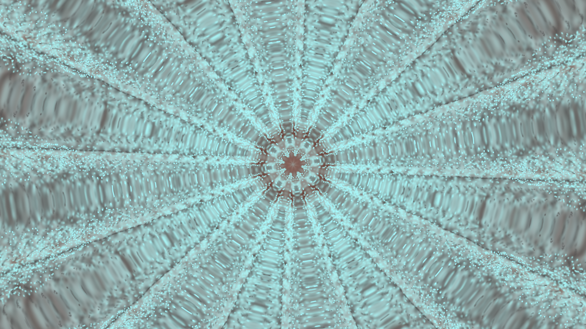

# Renderer line refactor

The Android engine port is based on ProjectM Android `09da40d1`, pinned projectM `6f64807467e312034883a4389e6aa80a675458bc`, evaluator `22fb0cfd8f2dfbcd2b68f2443e7f44e19b32c09a` and unchanged patches0001–0036. Patch0037 adapts upstream proposal [projectM-visualizer/projectm#1047](https://github.com/projectM-visualizer/projectm/pull/1047) at `ba122baa24cd1794c2a413ec8e308c8ab6e9e4fe`.

## Scope

Move generic colored points, padded batching, line drawing and line shader resources into Renderer. Extend Mesh to own/update streamed interleaved instance data, configure attributes/divisors/strip offsets and draw independent vertex/instance counts. Use Mesh for line strips and motion-vector quads. Retain the existing indexed draw path and keep MilkDrop sizing/sample/fade/dot/canvas/thick-pass policy in MilkdropPreset.

The TV engine retains constructor/prewarm shader compilation, uniform-location caching, per-instance shape styles, Native-trails prepared-geometry replay, packed/floating motion-UV sampling and shader-failure fallback. The generic shader source bytes are unchanged.

## Validation

Observed on Apple M4 Pro / macOS, 2026-10-17. Text log copies omit trailing trail-file padding; measurement/capture manifests and PNGs retain their recorded bytes:

- Before the Mesh port, its new API tests failed to compile on missing methods. The final host suite passes337 tests (baseline329 plus eight Mesh controls). The two bound-draw/layout-offset controls also observed their own missing-API RED before implementation.
- `./gradlew testDebugUnitTest`:207 JVM tests across app/core, zero failures/errors.
- `bash tools/check-patch-series.sh`: all37 patches apply. Earlier0001–0036 bytes are unchanged. The final patch includes removal/rename hunks, so a clean application does not leave unused old renderer/shader copies.
- Fresh recursive checkpoint `df4adb09`: `./gradlew :core:assembleDebug :app:assembleDebug` succeeds for both ARM ABIs. See `fresh-android-build.txt`; `:core` is shared by the TV and touchscreen app builds. `./gradlew :app:assembleDebug -PandroidTouchscreen=true` also succeeds; TV and Android APKs were staged separately before their shared output path changed. This is build evidence, not a device-rendering claim.
- `USE_GLES` syntax checks pass for the moved Renderer sources, Mesh and its tests. Line-strip and motion-vector programs link as GLSL330 and GLSL300ES with `glslangValidator`.
- Strict MkDocs1.6.1 / Material9.7.7 build passes.

### Matched source-engine output

`results.json` records54 paired cases,648 exact RGB frame pairs and1,296 total rendered frames. They use the36-patch baseline and final37-patch candidate at640×360,1920×1080 and3840×2160, with reference sizing off/on, AA and injected line compile/link failures. Three synthetic scenes cover double-strip main waves, custom waves, mixed per-instance shape thickness, outlines, dots and motion vectors. Nine extra4K cases exercise active Native Standard/Medium/High canvases; each reports active scale3 rather than fallback. Every case has12 frames, fixed synthetic stereo PCM and a30Hz public clock. Every pair is byte-identical, and every process reports zero preset-load and GL errors.

The harness explicitly binds the final output FBO for RGBA8 readback, strips alpha and hashes every RGB frame. `manifest.json` binds the source/artifact/helper/scene identities; `source-identities.json` records moved/changed source bytes. `verify.cpp` and the three`.milk` fixtures reproduce this bounded source-engine check. Timing columns are diagnostic only because two cases may render concurrently. This is a macOS source-engine comparison, not Android AAR, physical-TV, Windows/D3D, whole-corpus or performance certification.

`bash core/src/test/native/run_native_tests.sh` passes the native engine/JNI controls and all65 ASan/UBSan renderer tests. The standalone EGL/GLES transition overlay is skipped on this macOS host because its EGL/GLES development libraries are absent. Task-owned Android runtime comparison is complete:12 jobs across three unchanged real presets, each480 frames at3840×2160. Native-off and Standard settings match between roles; all six case pairs have exactly matching eight selected RGB frames (48 frame pairs,96 captured PNGs). Standard reports an active1280×720 canvas. Every job passes all480 strict GL/preset checks and core/EGL cleanup. Worker AARs include private clock/seed instrumentation, so they are distinct from shipping artifacts. The default API36 baseline failed surface initialization with GL_INVALID_OPERATION; a separately identified worker uses the existing public shader-binary-cache switch to disable caching for both roles, retaining every strict GL/preset/capture check. Those cache-off baseline jobs pass480 frames on each selected real preset. This emulator-specific comparison does not qualify the production program-binary cache. Existing historical image, corpus and timing evidence is preserved.

### Android evidence and limits

The owned TV emulator is `projectm_line_refactor_tv` / `emulator-5674`, captured Android user0, API36 ARM64, Android Emulator OpenGL ES Translator on Apple M4 Pro, host GPU/HVF and a4K TV display. The supplied44,100Hz worker signal remains the runner's frozen16-second unsigned mono PCM; production JNI retains its queried576-sample tail per frame. The host synthetic stereo signal above is a separate control.

`android/protocol.json` binds each actual instrumented AAR/worker, source/patch identities, driver fingerprint, user, PCM, clock/seed and profiles. `android/jobs/*/{manifest,row}.json` retain the480-frame invariants, eight selected PNG/RGB hashes, final-output read binding, Native status and serialized timing. The worker APK native bytes and assets were checked against the supplied AAR. Separate caller files record the bounded profile adaptation and safe resume; completed baseline jobs were verified and reused. The initial default-cache failure remains in `android/default-cache-baseline-failure.json`. Only the cache-off identities in the final protocol are accepted.

| Before: baseline36 patches, Royal103, Standard, frame479 | After:37 patches, same inputs |
|---|---|
|  |  |

These are copied unchanged from the validated final-output captures. Every selected before/after RGB pair matches; no appearance improvement is claimed. The timing values measure serialized `onDrawFrame` plus `glFinish`, excluding captures/PNG transport, on an emulator. They are not physical-TV app FPS or a universal performance result. One supplementary isolated City Lights legacy ABBA cycle (`android/city-abba/`) measures baseline7.905/8.965ms and candidate8.036/8.630ms (means8.435/8.333ms). All four capture sequences are identical. The overlapping variation does not establish a speedup or a universal no-regression result; no consistent increase is demonstrated by this one cycle.

### Collection-lock follow-up

The first reviewed CI run built the release TV/touchscreen APKs and full core AAR, then correctly rejected a stale collection lock. `docs/THIRD_PARTY.md` is included in the deterministic collection archive, so its updated patch provenance changes the archive identity even though every preset, texture and score is unchanged. Replacing only that notice with main's previous bytes reproduces the previous archive lock byte-for-byte (`archive-lock-causality.json`). The existing lock-archive command regenerates the updated identity; the failing archive build then passes, and all10 focused distribution tests pass. No generator logic, version base or preset data was changed.
