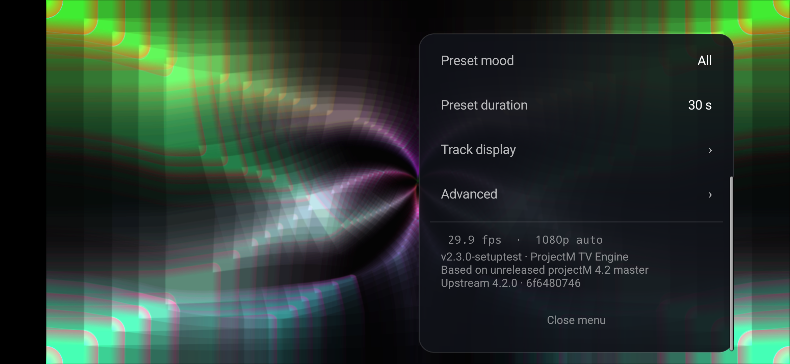
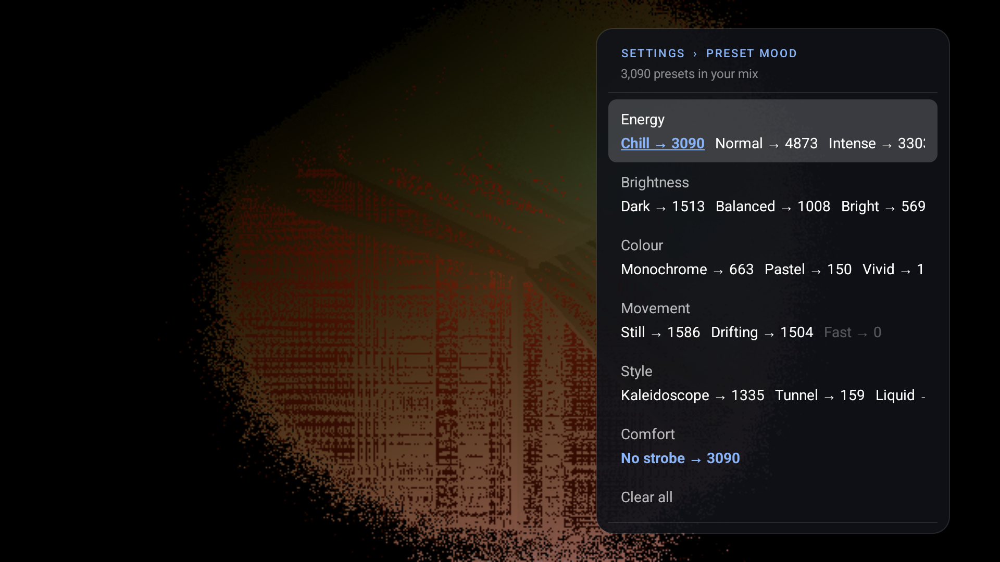

# Remote and touchscreen controls

## Touchscreen Android

Install **ProjectM Android** on a phone or tablet. It uses the same landscape visualizer and settings:

| Gesture | Action |
|---|---|
| Swipe right | Random preset, instant cut (same as remote Right) |
| Swipe left | Previous preset, instant cut (same as remote Left) |
| Single tap on the visuals | Open the menu; close it if already open |
| Tap a setting row | Cycle its value or run its action |
| Vertical swipe in a panel | Scroll to more settings |
| Back to menu / Close menu | Return from a submenu / close the panel |

A slow horizontal swipe works too. Vertical drags and cancelled gestures do not change presets. Scrolling a menu stays within that menu. Touch input restarts the 10-second inactivity timer; the menu stays open while a finger is down. The TV build retains its remote controls.

*Phone emulator capture from the touchscreen validation build. The version label identifies that build; the screenshot illustrates the touch menu layout.*

## TV remote: while visuals are showing

| Key | Action |
|---|---|
| Right, Next, Fast forward | Random preset, instant cut |
| Left, Previous, Rewind | Previous preset, instant cut |
| Up, Down, Info | Show the playing track again (needs notification access and Track info on) |
| Center, Enter, Menu | Open the settings panel |
| Back | Exit the app |

Switches from the remote are always instant cuts. Blends are used only for automatic preset changes.

## TV remote: in the settings panel

| Key | Action |
|---|---|
| Up / Down | Move between rows |
| Left / Right | Change the focused value |
| Center | Cycle the value, or run the row's action |
| Back | Close the panel; from **Advanced**, **Track display** or **Preset mood**, return to the main panel |
| Menu | Close the panel |

The panel hides after 10 seconds without input; every key press restarts that timer. The custom-pack upload dialog stays open until you close it.

## The main panel

On TV, when the panel opens, focus starts on the **Random** button, or on **Install** when an update is ready. From top to bottom the panel shows:

- **Preset**: the name of the playing preset.
- **Presets in rotation**: how many presets your current mix can play, and how many this TV has skipped.
- **Audio**: a live meter and status: *Listening*, *Very quiet*, *No sound* or *No access*.
- **Previous / Random / Next** buttons. *Next* follows the shuffled order; *Random* picks any preset in your mix. All three are instant cuts.
- On phones, **Audio input** chooses Microphone or Phone playback.
- **Auto change**, **Preset mood ›** and **Preset duration**, then **Track display ›** and **Advanced ›**.
- A status line with the current frame rate and render size (for example *30.0 fps · 4K auto*).
- The engine version: *v‹version› · ProjectM TV Engine / Based on unreleased projectM 4.2 master / Upstream 4.2.0 · 6f6480746*.

**Preset mood ›** opens the **Mood** panel (Settings › Preset mood):

- The header reads *N presets in your mix* (with *few presets: some repetition* under 20, and *No presets left in your mix; playing All* if every match is skipped on this device).
- A **Collection** row (*Built-in* or *Custom*) appears when a [custom pack](custom-packs.md) exists or Custom is chosen.
- Each group (**Energy**, **Brightness**, **Colour**, **Movement**, **Style**, **Comfort**) is one row. Left and Right move between its options, Center (or a tap on phones) switches the highlighted option on or off. Every option shows *→ N*: the presets you would have if you toggled it. Options that would leave no presets are dimmed and skipped.
- **Clear all** removes every selection (all presets play). Back returns to the main panel; the panel hides after 10 seconds without input.

Changing the mix keeps the current preset if it is still in the mix. Otherwise it cuts to a member. Previous-preset history restarts with the new mix. See [Preset moods](predictive-collections.md).

The [settings reference](settings.md) describes every row.
