# Predictions vs real renders

These are checkpoint presets: drawn at random from the 9,606 bundled presets with pre-registered seeds, predicted from their source, **frozen and hashed**, and only then rendered by the real engine. Each entry shows the frozen [prediction image](prediction-images.md) next to the emulator render at the same moment, a clip of the render, the measurements of both, the look description written before the render, and the moods the preset carries in the app.

The selection favours **chaotic presets the analysis gets right**: fast particle storms, fluid turbulence, feedback that churns every frame. They are the hardest test, because a small error in any mechanism (the warp, the decay orbit, a colour formula, the random stream) grows with every frame of feedback. A [section at the end](#where-it-misses) shows misses.

!!! info "How to read the numbers"
    *Brightness* and *saturation* are means over the picture (0–1). *Change per frame* is the mean absolute difference between consecutive frames: how busy the picture is. *Layout correlation* compares blurred brightness maps: 1.0 means the bright and dark regions are in the same places. Single frames of chaotic presets can differ even when the analysis is right, so the averages over frames 60–149 (2–5 s) carry more weight. All renders: published core library 2.3.34 in an Android emulator, 480×270, synthetic 110 BPM audio.

!!! warning "Flashing content"
    Clips contain fast motion. Presets that flash (10 or more brightness jumps per 10 s in the engine ruler) are shown as stills only, with no clip.

## Chaos, storms and turbulence

### suksma – delicious carnal amorality

*suksma - delicious carnal amorality.milk* · checkpoint r132

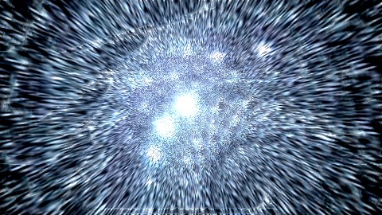{ width="49%" } 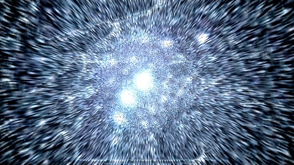{ width="49%" }

*Left: frozen prediction. Right: emulator render, frame 149 (5.0 s).*

<video src="../../images/predictor/clips/delicious-carnal-amorality.mp4" controls loop muted playsinline preload="none" width="480" poster="../../images/predictor/delicious-carnal-amorality-render.jpg"></video>

*The real render, 2–8 s (muted).*

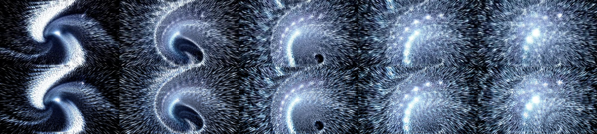

*Render (top) and current prediction (bottom) at 1, 2, 3, 4 and 5 seconds.*

| | Prediction | Render |
|---|---|---|
| Brightness, frame 149 | 0.424 | 0.424 |
| Mean colour, frame 149 | (0.36, 0.43, 0.53) | (0.35, 0.43, 0.54) |
| Brightness, frames 60–149 | 0.385 | 0.392 |
| Saturation, frames 60–149 | 0.348 | 0.362 |
| Change per frame, 60–149 | 0.1730 | 0.1729 |

Layout correlation: 0.91 for the single frames, 0.99 for the time-averaged pictures.

Written before the render (SDK look description):

> Overall this should read as a mid-brightness, blue-dominated, softly hazy picture. The simulated display statistics put mean luminance around 0.39 (calibrated interval 0.15-0.58), with about 90% of the screen coloured and nearly all of it blue (hue share 0.993 blue, a trace of cyan, saturation about 0.42). Warm/cool is clearly cool (about -0.44). The steady-state hue cue is also blue.

A dense blue particle storm spiralling into a smeared vortex. Every streak is redrawn and smeared each frame; the prediction tracks the vortex, the haze and the bright core frame by frame (see the strip).

In the app: **Energy** Normal, Intense · **Brightness** Balanced · **Colour** Cool · **Palette** Blue · **Main colour** Blue · **Style** Tunnel, Particles

### Crystal Liquid – the lights at night spikes

*ShadowHarlequin - Crystal Liquid - [EoS + Phat - the lights at night_spikes].milk* · checkpoint r208

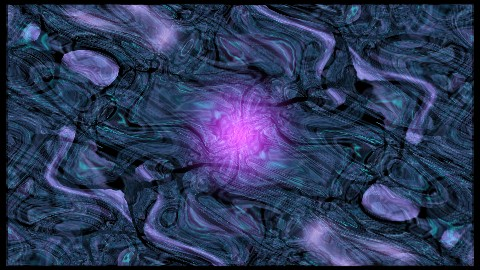{ width="49%" } 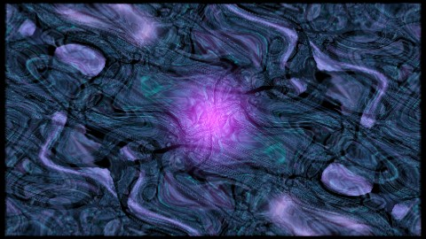{ width="49%" }

*Left: frozen prediction. Right: emulator render, frame 149 (5.0 s).*

<video src="../../images/predictor/clips/crystal-liquid-spikes.mp4" controls loop muted playsinline preload="none" width="480" poster="../../images/predictor/crystal-liquid-spikes-render.jpg"></video>

*The real render, 2–8 s (muted).*

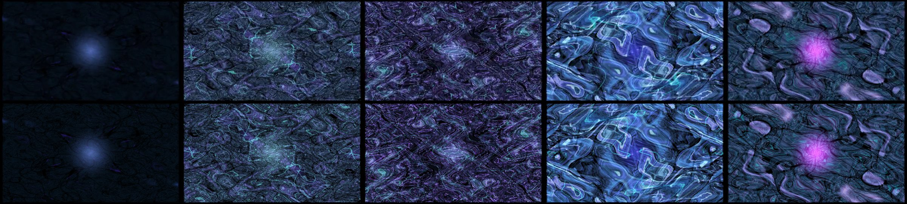

*Render (top) and current prediction (bottom) at 1, 2, 3, 4 and 5 seconds.*

| | Prediction | Render |
|---|---|---|
| Brightness, frame 149 | 0.219 | 0.219 |
| Mean colour, frame 149 | (0.17, 0.22, 0.35) | (0.17, 0.22, 0.35) |
| Brightness, frames 60–149 | 0.203 | 0.206 |
| Saturation, frames 60–149 | 0.556 | 0.561 |
| Change per frame, 60–149 | 0.1023 | 0.0964 |

Layout correlation: 0.99 for the single frames, 1.00 for the time-averaged pictures.

Written before the render (SDK look description):

> Colours: the calibrated estimate gives mean luminance about 0.34 (range 0.16 to 0.56), saturation about 0.5, and a cool lean. Likely hues are blue (about 0.52), then green (about 0.19), purple (about 0.11) and pink (about 0.11). The sources agree. The built-in circle has blue 0.98, with red and green varying with bass and treble. The 512-point custom wave is blue, purple and cyan at about half alpha.

Liquid, textured turbulence with a violet glow. The single frames match to two decimals in mean colour: (0.17, 0.22, 0.35) in both.

In the app: **Energy** Normal · **Colour** Cool · **Palette** Blue · **Main colour** Blue · **Movement** Drifting · **Style** Kaleidoscope

### Serge mashup001

*Serge mashup001.milk* · checkpoint r206

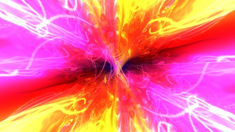{ width="49%" } 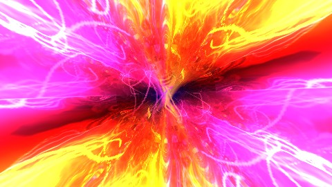{ width="49%" }

*Left: frozen prediction. Right: emulator render, frame 149 (5.0 s).*

<video src="../../images/predictor/clips/serge-mashup001.mp4" controls loop muted playsinline preload="none" width="480" poster="../../images/predictor/serge-mashup001-render.jpg"></video>

*The real render, 2–8 s (muted).*

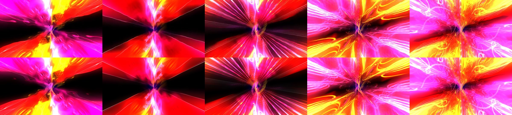

*Render (top) and current prediction (bottom) at 1, 2, 3, 4 and 5 seconds.*

| | Prediction | Render |
|---|---|---|
| Brightness, frame 149 | 0.556 | 0.546 |
| Mean colour, frame 149 | (0.97, 0.43, 0.55) | (0.95, 0.43, 0.53) |
| Brightness, frames 60–149 | 0.313 | 0.313 |
| Saturation, frames 60–149 | 0.811 | 0.813 |
| Change per frame, 60–149 | 0.0248 | 0.0253 |

Layout correlation: 1.00 for the single frames, 0.99 for the time-averaged pictures.

Written before the render (SDK look description):

> Colours: the calibrated display estimate puts the picture at moderate brightness (mean luminance about 0.34, range 0.16 to 0.57) and strong saturation (about 0.72). The likely leading hues are red (about 0.35 of coloured pixels), pink (about 0.30) and orange (about 0.19), with a little yellow. This matches the sources: two custom point layers are pink (1.0, 0.3, 0.6) and two are orange (1.0, 0.7, 0.1), each 512 points at about half alpha.

An exploding pink, red and yellow starburst. The palette, the dark rays and the bright centre all come from the source maths.

In the app: **Energy** Normal, Chill · **Colour** Vivid, Warm · **Palette** Red, Pink, Orange · **Main colour** none · **Movement** Drifting · **Style** Tunnel, Particles

### suksma – more Martinik theft

*suksma - more Martinik theft.milk* · checkpoint r39

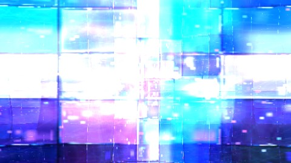{ width="49%" } 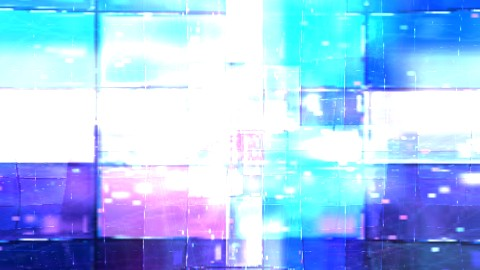{ width="49%" }

*Left: frozen prediction. Right: emulator render, frame 149 (5.0 s).*

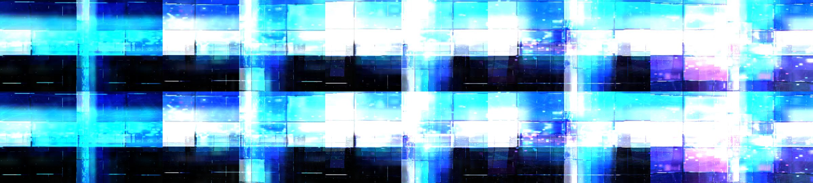

*Render (top) and current prediction (bottom) at 1, 2, 3, 4 and 5 seconds.*

| | Prediction | Render |
|---|---|---|
| Brightness, frame 149 | 0.732 | 0.761 |
| Mean colour, frame 149 | (0.60, 0.75, 0.95) | (0.64, 0.78, 0.95) |
| Brightness, frames 60–149 | 0.687 | 0.723 |
| Saturation, frames 60–149 | 0.413 | 0.364 |
| Change per frame, 60–149 | 0.1004 | 0.0955 |

Layout correlation: 0.99 for the single frames, 1.00 for the time-averaged pictures.

Written before the render (SDK look description):

> Core picture: a feedback scene built from several point-cloud "dust" layers (four custom waves, 512 points per frame each) plus one built-in audio waveform line (mode 7, two parallel left/right traces centred on screen). The points have closed-form positions, so they form smooth curves or sweeps of dots, not tracked particles. Two layers (wave_1, wave_2) are grayscale, spread over roughly the left/upper-centre area with moderate alpha (about 0.16 and 0.20).

Flickering, blown-out blue and white light panels: busy (0.10 change per frame) and still predicted to within a few percent in brightness. It flashes (22 brightness jumps per 10 s in the engine ruler), so it is shown as stills only and is not a No strobe preset.

In the app: **Energy** Intense · **Brightness** Bright · **Colour** Cool · **Palette** Blue, Green, Cyan · **Main colour** none · **Movement** Fast · **Style** Particles

### Royal – Mashup (190)

*$$$ Royal - Mashup (190).milk* · checkpoint r153

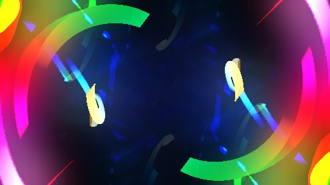{ width="49%" } 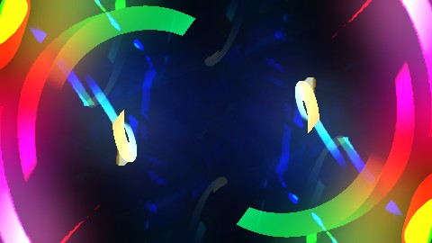{ width="49%" }

*Left: frozen prediction. Right: emulator render, frame 149 (5.0 s).*

<video src="../../images/predictor/clips/royal-mashup-190.mp4" controls loop muted playsinline preload="none" width="480" poster="../../images/predictor/royal-mashup-190-render.jpg"></video>

*The real render, 2–8 s (muted).*

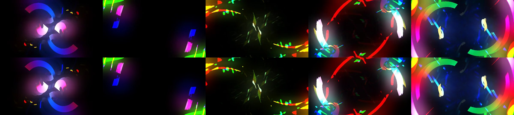

*Render (top) and current prediction (bottom) at 1, 2, 3, 4 and 5 seconds.*

| | Prediction | Render |
|---|---|---|
| Brightness, frame 149 | 0.259 | 0.250 |
| Mean colour, frame 149 | (0.32, 0.24, 0.31) | (0.30, 0.23, 0.30) |
| Brightness, frames 60–149 | 0.165 | 0.161 |
| Saturation, frames 60–149 | 0.392 | 0.400 |
| Change per frame, 60–149 | 0.0418 | 0.0414 |

Layout correlation: 1.00 for the single frames, 1.00 for the time-averaged pictures.

Written before the render (SDK look description):

> Brightness and colour: I expect a mostly neutral, grey-to-white picture on a black background, with possible green accents. The feedback canvas settles to a grey level (about 0.19 per channel), and the composite amplifies it steeply: a canvas level of 0.25 or more is shown as full white. So lit areas should read as bright, washed-out white or grey, and dim areas as black.

Shards and rings rotating out of the dark. The analysis predicted the full sequence of the first five seconds (see the strip).

In the app: **Energy** Normal · **Palette** Green, Blue, Red, Orange, Yellow, Pink · **Main colour** none · **Movement** Drifting · **Style** Particles

### martin – time machine (roam3)

*martin - time machine roam3 hosbital bilsce.milk* · checkpoint r125

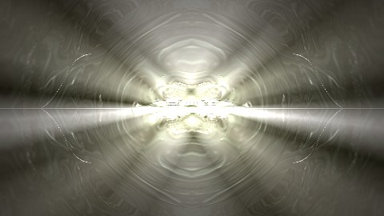{ width="49%" } 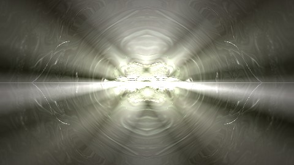{ width="49%" }

*Left: frozen prediction. Right: emulator render, frame 149 (5.0 s).*

| | Prediction | Render |
|---|---|---|
| Brightness, frame 149 | 0.433 | 0.423 |
| Mean colour, frame 149 | (0.44, 0.43, 0.39) | (0.43, 0.43, 0.38) |
| Brightness, frames 60–149 | 0.342 | 0.340 |
| Saturation, frames 60–149 | 0.316 | 0.314 |
| Change per frame, 60–149 | 0.2965 | 0.3176 |

Layout correlation: 1.00 for the single frames, 1.00 for the time-averaged pictures.

Written before the render (SDK look description):

> Approximate look after about 5 seconds: a mid-to-dark, green-tinted screen seen through an embossed (relief) composite, with a central ring-like disc, a horizontal line of coloured points across the middle, and a few small orange squares near the centre band. I expect it to be busy and possibly flickery rather than calm. Confidence is low to moderate; several decisive parts are unresolved.

A hard strobe (163 brightness jumps per 10 s in the engine ruler). Predicted frame by frame: over frames 60–149 the mean colour is 0.284/0.367/0.259 predicted and 0.283/0.366/0.259 rendered, and the frame-by-frame brightness series matches (0.69 predicted, 0.70 rendered at its brightest sampled frame). The look description written before the render said it is not safe for a No strobe setting. Shown as stills only.

In the app: **Energy** Intense · **Brightness** Balanced · **Palette** Green, Cyan, Blue · **Main colour** none · **Movement** Fast · **Style** Geometric

## Fluid and organic

### Various – Fire and Brimstone

*Various - Fire and Brimstone.milk* · checkpoint r101

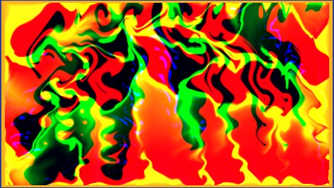{ width="49%" } 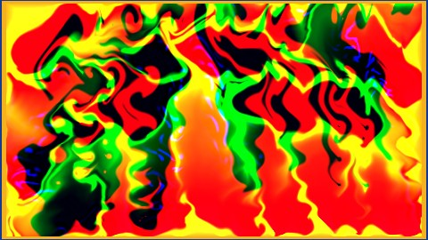{ width="49%" }

*Left: frozen prediction. Right: emulator render, frame 149 (5.0 s).*

<video src="../../images/predictor/clips/fire-and-brimstone.mp4" controls loop muted playsinline preload="none" width="480" poster="../../images/predictor/fire-and-brimstone-render.jpg"></video>

*The real render, 2–8 s (muted).*

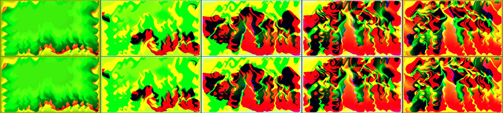

*Render (top) and current prediction (bottom) at 1, 2, 3, 4 and 5 seconds.*

| | Prediction | Render |
|---|---|---|
| Brightness, frame 149 | 0.405 | 0.411 |
| Mean colour, frame 149 | (0.66, 0.36, 0.08) | (0.66, 0.37, 0.08) |
| Brightness, frames 60–149 | 0.476 | 0.477 |
| Saturation, frames 60–149 | 0.876 | 0.876 |
| Change per frame, 60–149 | 0.0141 | 0.0141 |

Layout correlation: 0.93 for the single frames, 1.00 for the time-averaged pictures.

Written before the render (SDK look description):

> Core picture. "Various - Fire and Brimstone" is a feedback-driven preset: most of what is on screen is a self-evolving, smeared, organic texture rather than a few drawn objects.

Flame-like turbulence growing from green into red, yellow and black. Per-frame brightness stayed within 0.005 of the render at every sampled frame. The [feedback maths page](feedback-maths.md) explains why it is fire-coloured: the warp keeps red and green and cuts blue.

In the app: **Brightness** Bright · **Colour** Vivid, Warm · **Palette** Green, Red, Yellow · **Main colour** none · **Style** Liquid

### EoS + Phat – chasers 14 (Flowering Phoenix mix)

*EoS + Phat - chasers 14 sentinel 617_beta5_v2_Flowering_Phenoix_Mix.milk* · checkpoint r147

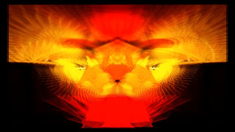{ width="49%" } 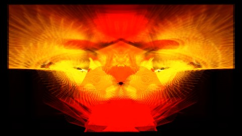{ width="49%" }

*Left: frozen prediction. Right: emulator render, frame 149 (5.0 s).*

<video src="../../images/predictor/clips/flowering-phoenix.mp4" controls loop muted playsinline preload="none" width="480" poster="../../images/predictor/flowering-phoenix-render.jpg"></video>

*The real render, 2–8 s (muted).*

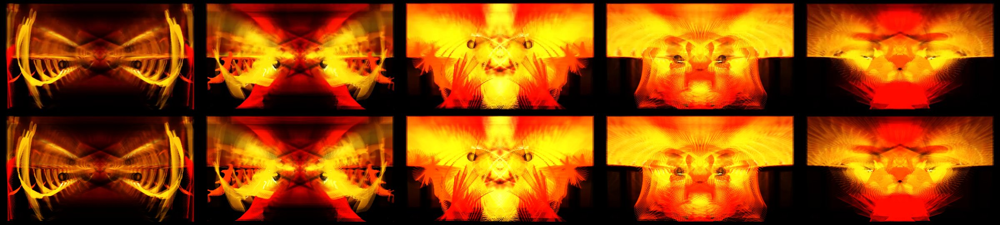

*Render (top) and current prediction (bottom) at 1, 2, 3, 4 and 5 seconds.*

| | Prediction | Render |
|---|---|---|
| Brightness, frame 149 | 0.267 | 0.275 |
| Mean colour, frame 149 | (0.54, 0.21, 0.01) | (0.55, 0.22, 0.01) |
| Brightness, frames 60–149 | 0.313 | 0.320 |
| Saturation, frames 60–149 | 0.875 | 0.873 |
| Change per frame, 60–149 | 0.0311 | 0.0296 |

Layout correlation: 0.98 for the single frames, 0.99 for the time-averaged pictures.

Written before the render (SDK look description):

> Structures: four custom waves of 512 points each. They are orange (two layers, one faint), red, and a pale yellow. They are drawn at about 50% alpha, so they read as dotted traces or point clouds, not solid lines. A built-in stereo-trace dot wave sits at screen centre but has alpha 0.001, so it is effectively invisible. Three polygons sit behind or around them. A very large 36-sided textured white disc at 50% alpha covers the whole screen and probably adds a soft texture wash.

Orange and red feathered flames over a mirrored figure, near frame-exact.

In the app: **Energy** Chill · **Colour** Vivid, Warm · **Palette** Red, Orange · **Main colour** none · **Movement** Drifting · **Style** Kaleidoscope, Particles

### EoS / Phat – Dark heart

*EoS_Phat Dark_heart_nobal_cause.milk* · checkpoint r105

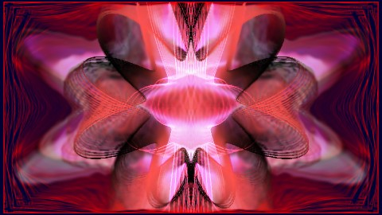{ width="49%" } 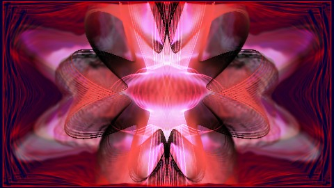{ width="49%" }

*Left: frozen prediction. Right: emulator render, frame 149 (5.0 s).*

<video src="../../images/predictor/clips/dark-heart.mp4" controls loop muted playsinline preload="none" width="480" poster="../../images/predictor/dark-heart-render.jpg"></video>

*The real render, 2–8 s (muted).*

| | Prediction | Render |
|---|---|---|
| Brightness, frame 149 | 0.264 | 0.264 |
| Mean colour, frame 149 | (0.51, 0.19, 0.30) | (0.51, 0.19, 0.30) |
| Brightness, frames 60–149 | 0.258 | 0.259 |
| Saturation, frames 60–149 | 0.720 | 0.720 |
| Change per frame, 60–149 | 0.0301 | 0.0302 |

Layout correlation: 1.00 for the single frames, 1.00 for the time-averaged pictures.

Written before the render (SDK look description):

> Core picture. A dark screen carrying a red-and-pink dotted cross at the centre, smeared by feedback into swirling, centre-pulling streaks. The drawn content is four 512-point custom waves (mechanism "point_cloud_primitive"/"custom_wave_primitive", independent particles not proven).

A dark screen carrying a red and pink cross, smeared by feedback into swirling, centre-pulling streaks.

In the app: **Energy** Normal, Chill · **Colour** Vivid, Warm · **Palette** Red, Pink · **Main colour** none · **Style** Kaleidoscope, Particles

### Phat / Aderrasi – Chromatic Abyss (the other side)

*Phat_Aderrasi - Chromatic Abyss (the other side)_PhatColours6.milk* · checkpoint r155

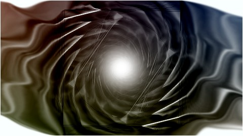{ width="49%" } 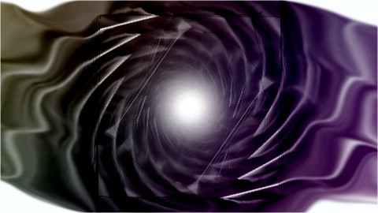{ width="49%" }

*Left: frozen prediction. Right: emulator render, frame 149 (5.0 s).*

<video src="../../images/predictor/clips/chromatic-abyss.mp4" controls loop muted playsinline preload="none" width="480" poster="../../images/predictor/chromatic-abyss-render.jpg"></video>

*The real render, 2–8 s (muted).*

| | Prediction | Render |
|---|---|---|
| Brightness, frame 149 | 0.261 | 0.219 |
| Mean colour, frame 149 | (0.28, 0.26, 0.23) | (0.26, 0.20, 0.26) |
| Brightness, frames 60–149 | 0.400 | 0.396 |
| Saturation, frames 60–149 | 0.184 | 0.160 |
| Change per frame, 60–149 | 0.0303 | 0.0282 |

Layout correlation: 0.99 for the single frames, 1.00 for the time-averaged pictures.

Written before the render (SDK look description):

> Brightness and colour: the calibrated estimate says medium-bright (mean luminance about 0.53, range 0.34 to 0.76) and only weakly saturated (about 0.21), with no clear warm or cool lean. The composite brightens up to roughly 2x (gamma 1.98) and blends a 50% copy of the image over itself, which should push the picture toward pale, near-white tones. The source does not fix the hues.

A swirling vortex of grey and dark colour. Brightness and structure are exact over time (time-average layout 0.997); the hue of the swirl differs between prediction and render, because part of its colour depends on the random tint drawn at load.

In the app: **Energy** Chill · **Brightness** Bright · **Palette** Blue, Pink, Green, Purple, Cyan · **Main colour** none · **Comfort** No strobe

## Symmetry, structure and geometry

### EoS and Zylot – skylight (Stained Glass Majesty mix)

*EoS and Zylot - skylight (Stained Glass Majesty mix).milk* · checkpoint r154

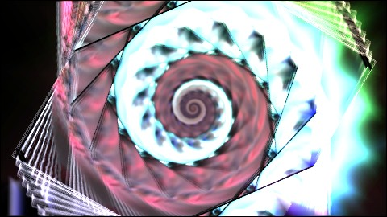{ width="49%" } 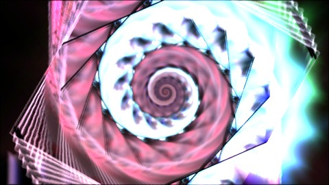{ width="49%" }

*Left: frozen prediction. Right: emulator render, frame 149 (5.0 s).*

<video src="../../images/predictor/clips/skylight-stained-glass.mp4" controls loop muted playsinline preload="none" width="480" poster="../../images/predictor/skylight-stained-glass-render.jpg"></video>

*The real render, 2–8 s (muted).*

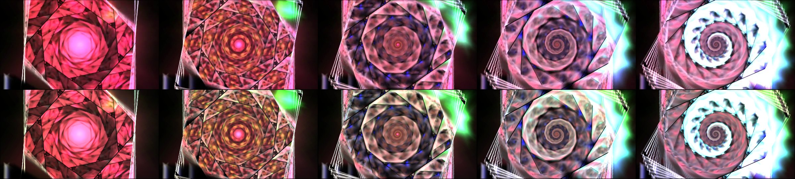

*Render (top) and current prediction (bottom) at 1, 2, 3, 4 and 5 seconds.*

| | Prediction | Render |
|---|---|---|
| Brightness, frame 149 | 0.566 | 0.582 |
| Mean colour, frame 149 | (0.57, 0.56, 0.58) | (0.62, 0.56, 0.63) |
| Brightness, frames 60–149 | 0.428 | 0.406 |
| Saturation, frames 60–149 | 0.265 | 0.376 |
| Change per frame, 60–149 | 0.0249 | 0.0240 |

Layout correlation: 0.97 for the single frames, 0.99 for the time-averaged pictures.

Written before the render (SDK look description):

> Feedback: decay is 1.0 and the warp is nearly the identity (zoom 1, rotation 0, no translation, tiny warp 0.01). So nothing flows, spins or zooms, and drawn content is never faded by the decay. Whatever gets painted stays and piles up. The only erasing is a thin black border (about 1% of the screen) redrawn every frame. Expect no streaks or tunnel; the picture changes only by new drawing on top of old.

Nothing flows: decay 1.0 and an almost identity warp, so the picture only changes by new drawing piling up on old. The analysis says exactly that, and the spiral builds up on the same schedule (see the strip).

In the app: **Energy** Chill · **Brightness** Bright · **Palette** Red, Green, Pink, Cyan, Blue, Orange · **Main colour** none · **Movement** Drifting · **Style** Particles · **Comfort** No strobe

### EoS – repeater 06 (rave on a lot of acid)

*EoS - repeater 06 - rave on a lot of acid.milk* · checkpoint r91

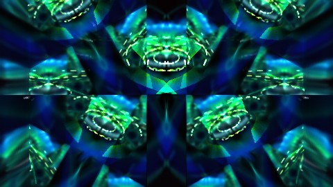{ width="49%" } 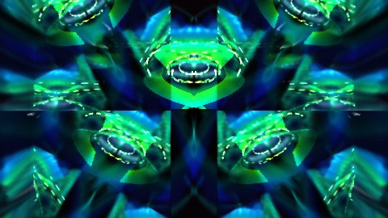{ width="49%" }

*Left: frozen prediction. Right: emulator render, frame 149 (5.0 s).*

<video src="../../images/predictor/clips/repeater-06-acid.mp4" controls loop muted playsinline preload="none" width="480" poster="../../images/predictor/repeater-06-acid-render.jpg"></video>

*The real render, 2–8 s (muted).*

| | Prediction | Render |
|---|---|---|
| Brightness, frame 149 | 0.216 | 0.260 |
| Mean colour, frame 149 | (0.05, 0.26, 0.30) | (0.05, 0.32, 0.32) |
| Brightness, frames 60–149 | 0.136 | 0.160 |
| Saturation, frames 60–149 | 0.617 | 0.627 |
| Change per frame, 60–149 | 0.0208 | 0.0215 |

Layout correlation: 0.96 for the single frames, 0.95 for the time-averaged pictures.

Written before the render (SDK look description):

> Core picture. This is a feedback-driven scene built from four large four-sided polygons (radius about 0.89 NDC, so each is huge and they overlap heavily), four custom 512-point waveform/point layers (wave_0 to wave_3, positions are closed-form functions of time, not tracked particles), plus the built-in wave drawn as dots (mode 2, a stereo X/Y trace centred at 0.5, 0.5).

A mirrored grid of green and blue acid shapes: four huge overlapping polygons and four point layers, tiled by the composite.

In the app: **Energy** Chill · **Colour** Vivid · **Palette** Pink, Green, Blue, Red · **Main colour** none · **Style** Kaleidoscope, Particles

### EoS – glowsticks v2 03 (roaming)

*EoS - glowsticks v2 03 music shifter edit b (Stahl's Reactive RMX) [+ flexi's reflections] [roaming].milk* · checkpoint r43

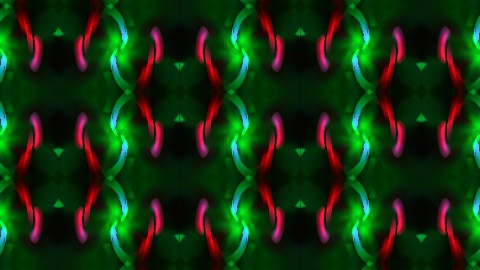{ width="49%" } 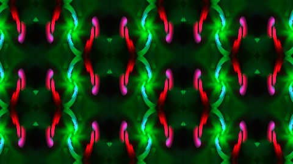{ width="49%" }

*Left: frozen prediction. Right: emulator render, frame 149 (5.0 s).*

<video src="../../images/predictor/clips/glowsticks-v2-03.mp4" controls loop muted playsinline preload="none" width="480" poster="../../images/predictor/glowsticks-v2-03-render.jpg"></video>

*The real render, 2–8 s (muted).*

| | Prediction | Render |
|---|---|---|
| Brightness, frame 149 | 0.155 | 0.172 |
| Mean colour, frame 149 | (0.08, 0.19, 0.06) | (0.09, 0.20, 0.07) |
| Brightness, frames 60–149 | 0.157 | 0.166 |
| Saturation, frames 60–149 | 0.648 | 0.626 |
| Change per frame, 60–149 | 0.0417 | 0.0429 |

Layout correlation: 0.98 for the single frames, 1.00 for the time-averaged pictures.

Written before the render (SDK look description):

> Core picture: a black canvas with sparse, glowing line-and-dot work drawn over a strongly zooming feedback trail. The drawn elements are a stereo X/Y waveform trace rendered as dots at screen centre (built-in mode 2, left/right audio as the two axes), two custom point-cloud waves of 512 points each, and two five-sided polygon shapes with oversized nominal radii (about 1.76 and 1.07 NDC).

Green and red glowsticks repeated across the screen by a strong zooming feedback trail.

In the app: **Energy** Normal · **Colour** Vivid · **Palette** Pink, Green, Blue, Red · **Main colour** none · **Movement** Drifting · **Style** Particles

### 298

*298.milk* · checkpoint r170

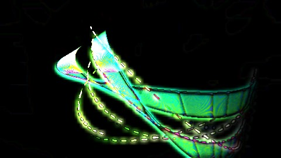{ width="49%" } { width="49%" }

*Left: frozen prediction. Right: emulator render, frame 149 (5.0 s).*

<video src="../../images/predictor/clips/298.mp4" controls loop muted playsinline preload="none" width="480" poster="../../images/predictor/298-render.jpg"></video>

*The real render, 2–8 s (muted).*

| | Prediction | Render |
|---|---|---|
| Brightness, frame 149 | 0.131 | 0.130 |
| Mean colour, frame 149 | (0.08, 0.15, 0.10) | (0.08, 0.15, 0.10) |
| Brightness, frames 60–149 | 0.071 | 0.069 |
| Saturation, frames 60–149 | 0.548 | 0.569 |
| Change per frame, 60–149 | 0.0343 | 0.0333 |

Layout correlation: 1.00 for the single frames, 1.00 for the time-averaged pictures.

Written before the render (SDK look description):

> Colour: the built-in wave is a dim orange-brown dot trace. Its alpha is only 0.001, so it is nearly invisible. Custom waves 0 and 1 carry broad, saturated hues (green, orange, blue, cyan, pink, purple, mean saturation about 0.91). Their hue varies along the trace, so it looks like a multicolour dotted line, not one tint. Waves 2 and 3 are authored orange and red-orange dot clouds. A small five-sided shape is white at the centre and blue toward the edge.

Multicoloured dotted traces over a zooming green shape, exact to 0.002 in brightness.

In the app: **Palette** Pink, Green, Blue, Orange · **Main colour** none · **Movement** Drifting · **Style** Particles

### suksma – out of fuckus (newband plays harry partch)

*suksma - out of fuckus newband plays harry partch - shf.milk* · checkpoint r74

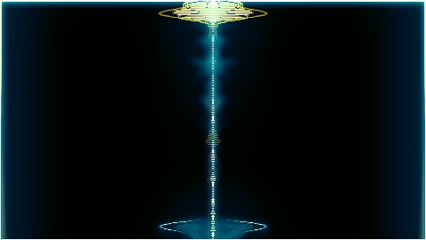{ width="49%" } 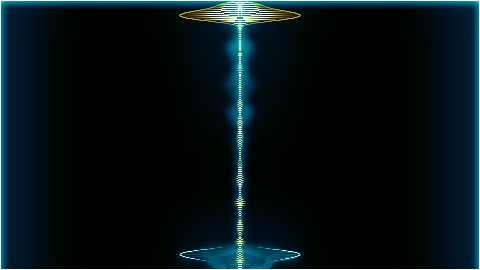{ width="49%" }

*Left: frozen prediction. Right: emulator render, frame 149 (5.0 s).*

<video src="../../images/predictor/clips/harry-partch.mp4" controls loop muted playsinline preload="none" width="480" poster="../../images/predictor/harry-partch-render.jpg"></video>

*The real render, 2–8 s (muted).*

| | Prediction | Render |
|---|---|---|
| Brightness, frame 149 | 0.068 | 0.063 |
| Mean colour, frame 149 | (0.03, 0.08, 0.09) | (0.02, 0.07, 0.09) |
| Brightness, frames 60–149 | 0.029 | 0.030 |
| Saturation, frames 60–149 | 0.896 | 0.898 |
| Change per frame, 60–149 | 0.0092 | 0.0095 |

Layout correlation: 0.98 for the single frames, 0.99 for the time-averaged pictures.

Written before the render (SDK look description):

> Core picture: a dark, soft, smoky feedback canvas with four custom line-waveform layers (512 points each) drawn into it. The strongest visible drawn element is wave_1, a translucent (mean alpha about 0.5), highly saturated line (mean saturation 0.99) coloured about 86% pink, 11% purple and 3% blue. wave_3 is a very faint grey line (alpha about 0.025) that adds only a subtle haze.

A dark, smoky canvas with a single bright vertical trace and glowing caps. The frozen prediction matches the render almost exactly (single-frame layout 0.98, mean colour equal to 0.001). The shipped mood, however, says **Intense**, while the render is calm (0.008 change per frame): one of the wrong Intense labels. The prediction image and the mood come from different paths (images are never used for moods), and the calibrated activity estimate misreads this preset.

In the app: **Energy** Intense · **Brightness** Dark · **Colour** Vivid, Cool · **Palette** Blue, Green · **Main colour** none · **Style** Kaleidoscope

### fiShbRaiN – quark matrix

*fiShbRaiN - quark matrix.milk* · checkpoint r143

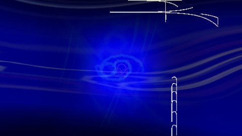{ width="49%" } 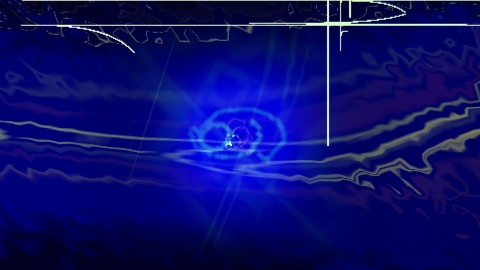{ width="49%" }

*Left: frozen prediction. Right: emulator render, frame 149 (5.0 s).*

<video src="../../images/predictor/clips/quark-matrix.mp4" controls loop muted playsinline preload="none" width="480" poster="../../images/predictor/quark-matrix-render.jpg"></video>

*The real render, 2–8 s (muted).*

| | Prediction | Render |
|---|---|---|
| Brightness, frame 149 | 0.063 | 0.079 |
| Mean colour, frame 149 | (0.03, 0.03, 0.46) | (0.04, 0.05, 0.42) |
| Brightness, frames 60–149 | 0.026 | 0.030 |
| Saturation, frames 60–149 | 0.886 | 0.858 |
| Change per frame, 60–149 | 0.0320 | 0.0332 |

Layout correlation: 0.82 for the single frames, 1.00 for the time-averaged pictures.

Written before the render (SDK look description):

> Structures: a thick, additive stereo waveform trace (built-in mode 3, driven by left and right channels) centred on the screen, drawn as a Lissajous-like line. Four custom 512-point waves are layered with it. Their positions are known only as closed-form functions of bass, mid and treble, so I cannot say where they sit. At the centre there is a very large 4-sided shape, radius about 1.79 in NDC.

A deep-blue field with a thick waveform trace and a pale crosshair; the overall field and level are exact, the line details differ.

In the app: **Brightness** Dark · **Palette** Blue, Green · **Main colour** none

## Where it misses

Predictions are not always right. These entries show the main kinds of miss and what they taught.

### hyperbottock – terribly healthy society

*hyperbottock scream troy knob scan nz+ sectsiscentialist phuqstiq terribly sick individual critisizes terribly healthy society.milk* · checkpoint r186

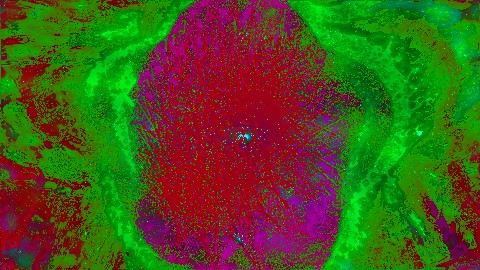{ width="49%" } 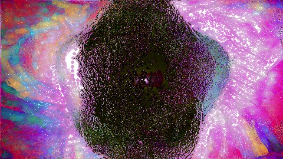{ width="49%" }

*Left: frozen prediction. Right: emulator render, frame 149 (5.0 s).*

| | Prediction | Render |
|---|---|---|
| Brightness, frame 149 | 0.303 | 0.385 |
| Mean colour, frame 149 | (0.28, 0.33, 0.10) | (0.50, 0.34, 0.47) |
| Brightness, frames 60–149 | 0.294 | 0.301 |
| Saturation, frames 60–149 | 0.366 | 0.383 |
| Change per frame, 60–149 | 0.2419 | 0.2338 |

Layout correlation: -0.49 for the single frames, 0.98 for the time-averaged pictures.

Written before the render (SDK look description):

> Drawn content: a ring of dots from a rotating stereo trace sits at screen centre, with a tiny effective radius, so it reads as a small spinning dot cluster. A 512-point custom curve is multicoloured (grey, red, blue, green, yellow mixes). A group of 1024 twenty-sided polygon copies and 33 thirty-two-sided copies move with the audio, and a second black 256-point curve can cut dark lines through the colour.

**Colour miss.** Structure and brightness agree, but the prediction is green and red where the render is pink and black. Several of this preset's colours come from values redrawn at random; the analysis knows the range, not the draw. It also strobes (108 brightness jumps per 10 s), so it is shown as stills only.

In the app: **Energy** Intense · **Brightness** Balanced · **Colour** Vivid · **Palette** Green, Blue, Pink · **Main colour** none · **Movement** Fast · **Style** Kaleidoscope, Liquid, Geometric, Particles

### suksma – tetraxectsual (Isosceles edit 16)

*suksma - tetraxectsual aeliaen kkuhltz --- Isosceles edit16.milk* · checkpoint r163

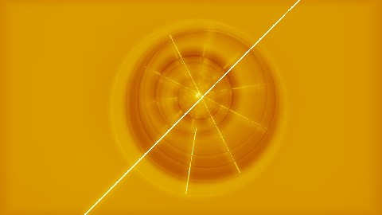{ width="49%" } 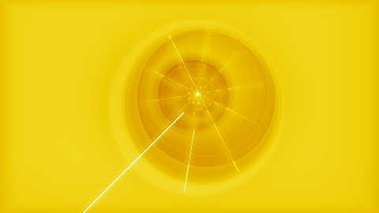{ width="49%" }

*Left: frozen prediction. Right: emulator render, frame 149 (5.0 s).*

| | Prediction | Render |
|---|---|---|
| Brightness, frame 149 | 0.587 | 0.765 |
| Mean colour, frame 149 | (0.84, 0.57, 0.01) | (0.92, 0.79, 0.06) |
| Brightness, frames 60–149 | 0.437 | 0.541 |
| Saturation, frames 60–149 | 0.994 | 0.982 |
| Change per frame, 60–149 | 0.1056 | 0.0884 |

Layout correlation: 0.75 for the single frames, 0.98 for the time-averaged pictures.

Written before the render (SDK look description):

> Structure: the warp is a source-point radial mechanism covering the whole screen, converging on a fixed centre (0.5, 0.5). Everything drawn is smeared into coloured rays or spokes radiating from the middle, with colour varying by angle. Drawn on top is a 44-sided, almost circular polygon of radius about 0.81 near the centre. It drifts very slowly (a few hundredths of a screen, with periods of roughly 9 s).

**Level miss.** Structure and palette are right (layout 0.98, a red-orange-yellow fire ramp with near-zero blue), but the canvas level is about 20% low (0.48 against about 0.58) behind a steep composite curve, so the prediction is a darker orange where the render is bright yellow. Errors in the feedback level are the most common kind of miss. It pulses hard with the music (125 jumps per 10 s), so it is shown as stills only.

In the app: **Energy** Intense · **Brightness** Bright · **Colour** Vivid, Warm · **Palette** Orange, Yellow · **Main colour** none · **Movement** Drifting

### Stahlregen & Boz – Machine Code (Reaction Diffusion)

*Stahlregen & Boz - Machine Code (Reaction Diffusion)_1 - Isosceles Tweak 04.milk* · checkpoint r122

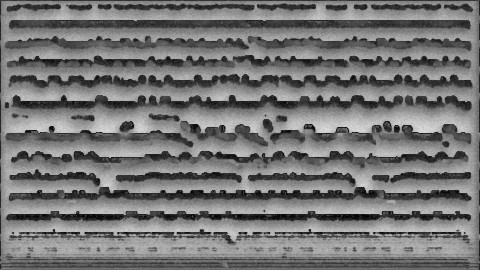{ width="49%" } 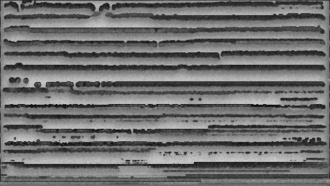{ width="49%" }

*Left: frozen prediction. Right: emulator render, frame 149 (5.0 s).*

<video src="../../images/predictor/clips/machine-code-reaction-diffusion.mp4" controls loop muted playsinline preload="none" width="480" poster="../../images/predictor/machine-code-reaction-diffusion-render.jpg"></video>

*The real render, 2–8 s (muted).*

| | Prediction | Render |
|---|---|---|
| Brightness, frame 149 | 0.461 | 0.440 |
| Mean colour, frame 149 | (0.46, 0.46, 0.46) | (0.44, 0.44, 0.44) |
| Brightness, frames 60–149 | 0.506 | 0.464 |
| Saturation, frames 60–149 | 0.000 | 0.000 |
| Change per frame, 60–149 | 0.1353 | 0.1415 |

Layout correlation: 0.10 for the single frames, 0.84 for the time-averaged pictures.

Written before the render (SDK look description):

> Core picture

**Chaotic detail.** The single frames barely correlate (0.10), yet the analysis is right: grey reaction-diffusion stripes grow upward on the same schedule, and the time-averaged pictures correlate at 0.84. For chaotic presets only statistics can match.

In the app: **Brightness** Bright · **Colour** Monochrome · **Palette** none (grey) · **Main colour** none · **Comfort** No strobe

## More checkpoints

The research branch keeps every checkpoint (`docs/superpowers/evidence/source-understanding-checkpoints-2026-10-11/`, nearly 400 folders): selection, frozen prediction, look description, comparison image, self-comparison record. The [journal](journal.md) lists the misses that changed the mathematics.
