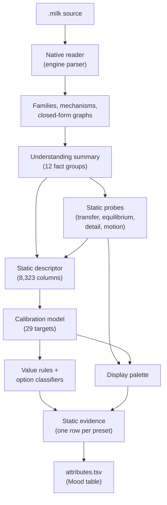

# From estimates to moods

The [source reading](source-reading.md) and the [closed-form maths](feedback-maths.md) produce thousands of facts per preset. This page explains how those facts become the eight values and the mood options in the shipped table, and how the table is checked.



## 1. The static descriptor

`static_descriptor.descriptor` (policy `static-summary-descriptor-v4`) turns a preset's understanding summary and its static probes into a flat row of numbers:

- every numeric or yes/no fact becomes a column (lists are aggregated as maximum, mean and count);
- short text facts become one-hot columns;
- derived groups are added: `equilibrium:*` (canvas and display levels from the [feedback equilibrium](feedback-maths.md#2-where-the-canvas-settles-feedback-equilibrium), gain, offset, energy per frame, trail distribution), `frameprog:*` (periods of autonomous per-frame recurrences, brightness outputs driven by band thresholds) and `recipe:*` (transfer tables, detail gains, colour matrix ratios, the static palette).

The shipped model uses **8,323 columns**, by family: motion 2,440, feedback 1,551, colour 1,299, flashing 892, geometry 664, audio 494, construction 428, shape state 267, uncertainty 108, mood 71, recipe 53, equilibrium 34, context 17, per-frame program 5. Columns present in fewer than 1% of presets are dropped.

## 2. The calibration model

The closed forms describe parts of the loop exactly, but the whole picture combines them in ways no single formula captures. The calibration model learns that combination: given a preset's static columns, what does the engine actually show?

**Training labels** come from the **engine ruler**: every bundled preset rendered once by the pinned, patched engine (macOS GLES under SwiftShader), 480×270, 300 frames at 30 fps with one synthetic audio track, measured over frames 60–299. The ruler's measurements are used only as training targets and to score the model; they never enter the shipped table.

**Model**: gradient-boosted decision trees (scikit-learn `HistGradientBoostingRegressor`: 250 iterations, learning rate 0.06, at most 15 leaves, at least 20 presets per leaf). At prediction time the model is plain JSON tree-walking with no third-party packages (`fixtures/calibrated-display-model.json.gz`, 3.2 MB).

**Out of fold**: all scores are computed with 5-fold cross-validation: each preset is predicted by a model that never saw it. The final model is then trained on all presets, and the 10th–90th percentile of the out-of-fold errors becomes each estimate's **interval**.

| Target | Meaning | Out-of-fold rank correlation (Spearman) |
|---|---|---|
| `mean_luminance` | Average brightness, 0–1 | 0.696 |
| `mean_abs_frame_difference` | Average change between consecutive frames, 0–1 | 0.729 |
| `mean_flow_screen_widths_per_s` | Motion speed, screen widths per second | 0.694 |
| `global_brightness_jumps_per_10s` | Whole-screen brightness jumps per 10 s | 0.774 |
| `mean_saturation` | Average saturation, 0–1 | 0.703 |
| `warm_cool` | Warm/cool balance, −1 to +1 | 0.657 |
| `coloured_share` | Fraction of the picture that is coloured | 0.682 |
| `hue_share_<family>` (8) | Share of each hue family among coloured pixels | 0.509–0.654 |
| `hue_top_share` | Share of the most common hue family | 0.638 |

A rank correlation around 0.7 means the model orders presets by brightness or motion well, but an individual estimate can still be off. That is why the options do not simply apply thresholds to these estimates; see the next section.

## 3. From values to options

The mood definition (`tools/milk-analyzer/facets/facets-v1.json`) sets a rule for each option on the values:

| Group | Options and rules |
|---|---|
| Energy | Chill: activity ≤ 0.35 · Normal: 0.25–0.75 · Intense: ≥ 0.70 |
| Brightness | Dark: luminance < 0.12 · Balanced: 0.12–0.40 · Bright: > 0.40 |
| Colour | Monochrome: coloured share < 0.1 · Pastel: luminance > 0.35, saturation < 0.3, not Monochrome · Vivid: saturation ≥ 0.5 · Warm: warm/cool ≥ 0.25 · Cool: warm/cool ≤ −0.25 |
| Movement | Still: flow < 0.05 · Drifting: 0.05–0.25 · Fast: > 0.25 |
| Comfort | No strobe: fewer than 1 brightness jump per 10 s |

**Activity** (Energy) is a percentile: the frame difference, flow and jumps estimates are each placed in frozen 1001-point reference tables (`facets/activity-reference-v1.json`, measured once on the 9,606 presets and never recomputed), their mid-ranks are averaged, and that average is placed in a frozen table of averages. A frozen scale means a future collection does not shift what "Chill" means.

### Why rules on estimates are not enough

Estimates from a regression **shrink toward the middle**: an uncertain preset is predicted near the average. Applied directly, the rules admitted extremes precisely but rarely (Dark at 82% precision but only 19% recall) and flooded the middle options (Balanced at 53% precision). For mood selection that is the wrong trade-off: if you pick Balanced, you should get balanced presets.

### Option classifiers

So each option except Vivid and Fast has its own **classifier** (gradient-boosted trees, 300 iterations, stratified 5-fold out-of-fold scoring) that predicts directly whether the engine would put the preset in that option. Each classifier's threshold is set where its out-of-fold precision reaches a floor:

| Option | Threshold | Out-of-fold AUC | Precision floor |
|---|---|---|---|
| Dark | 0.583 | 0.870 | rule precision |
| Bright | 0.436 | 0.866 | rule precision |
| Monochrome | 0.723 | 0.895 | 93% target |
| Pastel | 0.607 | 0.828 | **70%** |
| Warm | 0.511 | 0.887 | rule precision |
| Cool | 0.498 | 0.873 | rule precision |
| Still | 0.576 | 0.865 | rule precision |
| Chill | 0.685 | 0.882 | rule precision |
| Intense | 0.427 | 0.900 | rule precision |
| Balanced | 0.720 | 0.729 | **80%** |
| Drifting | 0.718 | 0.735 | **80%** |
| Normal | 0.713 | 0.755 | **80%** |

The floors for the in-between options (80%) and Pastel (70%) were owner decisions. At 80% the middle options drop about 2,330 wrong labels and about 4,230 correct ones compared with a 70% floor; for choosing moods, fewer wrong presets in a pool matters more than bigger pools.

The decision runs in four steps (`preset_recipe.facets_block`):

1. **Value rules** on the calibrated estimates give a first set of options.
2. **Activity** is computed from the calibrated frame difference, flow and jumps.
3. **Classifiers override**: for each option with a classifier, the classifier alone decides (admit at or above its threshold, remove below it, even if the rule admitted it). When two conflicting options in a group are both admitted (Dark and Balanced, for example), the one further above its own threshold stays.
4. **No strobe gate**: admitted only when the No strobe classifier (trained to separate presets with fewer than 1 jump per 10 s, with flickering and strobing presets weighted 2× and 4×, out-of-fold AUC 0.921) gives **at least 0.93** *and* the jumps estimate is **below 0.05** per 10 s. Out of fold this admitted 599 presets and no strobing preset; the highest-scoring strobing preset scored 0.906.

**Style** options come from proven mechanisms and structure scores (`facet_style_facts`): Kaleidoscope from an angular mirror fold or symmetry ≥ 0.55; Tunnel from polar radial sampling; Liquid from image- or gradient-driven advection with an organic score ≥ 0.6; Geometric from a geometric score ≥ 0.6; Particles from point-cloud primitives or procedural point motion; Fractal from a nonlinear feedback map, a complex quadratic recurrence or a fractal score ≥ 0.6.

**Palette and Main colour** come from the [display palette](colour.md).

## 4. The static evidence

`static_evidence_export.py` on the research branch runs this chain for every bundled preset and writes one gzip JSON file:

```json
{"schema": "projectm-tv-static-mood-evidence", "version": 1,
 "producer": {"branch": "feat/predictor-static-output-bounds", "commit": "<research commit>",
              "calibration_model_sha256": "<model hash>",
              "policy": "static source analysis only; no ruler or simulation values"},
 "rows": [{"name": "Various - Fire and Brimstone.milk", "sha256": "ddc3d588…cf914",
           "options": ["bright", "vivid", "warm", "liquid"],
           "palette": ["green", "red", "yellow"], "dominant": null,
           "values": {"luminance": 0.491, "saturation": 0.804, "coloured_share": 0.826, "warm_cool": 0.449,
                      "flow": 0.095, "frame_difference": 0.034, "jumps": 0.0, "activity": 0.309}}]}
```

The preset's name is removed before the options are decided, so the analysis can never look up an existing table row. The file is committed to `main` at `docs/superpowers/evidence/static-mood-table-2026-10-16/static-evidence.json.gz`; the [JSON page](json-output.md#the-mood-evidence) explains every field.

## 5. The shipped table

`tools/milk-analyzer/attribute_bundle.py --build-static <evidence>` writes three files into `core/src/main/assets/preset-attributes/`:

- **`facets.json`**: the definition, a copy of `facets-v1.json`.
- **`attributes.tsv`**: a header (`#group`, `#option` and `#columns` lines) and one tab-separated line per preset: name, comma-separated options in definition order, and the eight values with 4 decimals (`-` for none). Palette options are the family names (`red` … `pink`), Main colour options are `main_red` … `main_pink`. A grey preset (Monochrome) never carries either.
- **`manifest.json`**: `source: static-analysis`, the evidence's SHA-256 and producer, hashes of the definition, `presets.idx` and the table, the preset count, the number of rows with values, analysis errors and per-option counts.

The app reads only the header and the options; the values are kept for tools and for people curious about a preset. The table is about 1.6 MB uncompressed and about 400 KB as stored in the APK, roughly 42 bytes per preset. Adding Palette and Main colour cost about 25 KB in total.

## 6. How CI keeps the table honest

`attribute_bundle.py --check` runs on every build. For a static table it fails when:

- `facets.json` differs from the definition, or any manifest hash is stale;
- a preset in `presets.idx` has no evidence row, or the evidence names a preset that is not bundled;
- a preset file's bytes differ from the SHA-256 it was analysed with (an edited preset fails until it is analysed again);
- any table line differs from the line rebuilt from its evidence row (options, order, values);
- an evidence option or colour is not in the definition;
- the manifest's counts, producer or source differ from what the rows say;
- the compressed table exceeds **450,000 bytes**.

The earlier engine-ruler table and its checks remain in the tool for history, but no longer produce the shipped table.

## 7. Presets outside the bundle

The analysis runs offline in Python on the research branch; nothing analyses presets on your TV. Presets from a [custom pack](../custom-packs.md) therefore have no moods and do not play while a mood option is active. Analysing user packs on the device is out of scope for now.
